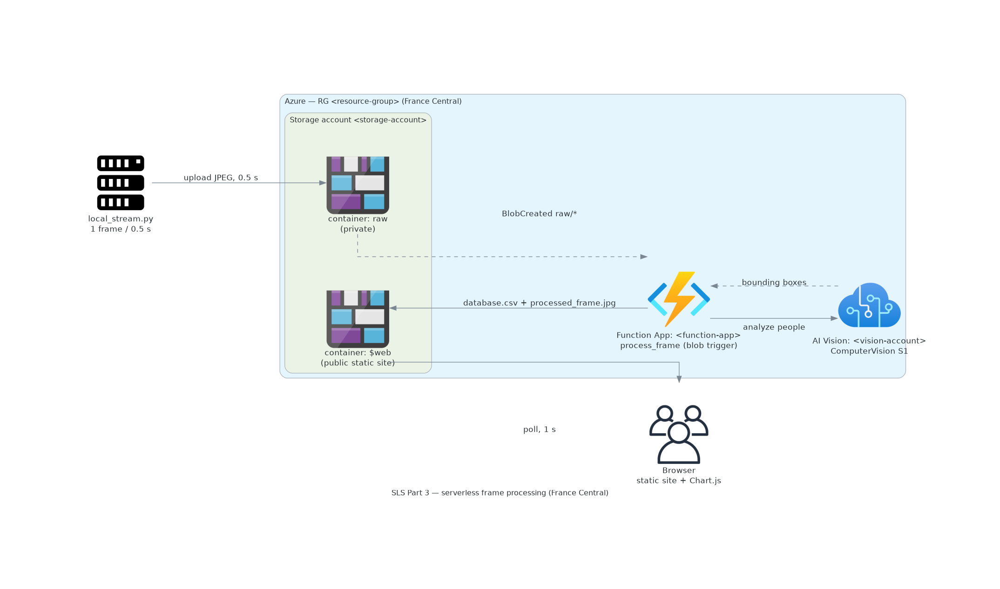

# SLS architecture

Design documentation for the Smart Lighting System pipeline. This page documents the **Part 3
serverless** architecture and the **Part 4 multi-camera** contract; Parts 1–2 (local and Azure VM)
are covered by `README.md` and the module docs under `src/`. It is a description of the design, not
of any running environment.

## Part 3 — serverless frame processing

*Generated by [`scripts/build_architecture_diagram.py`](../scripts/build_architecture_diagram.py);
regenerate with `venv/bin/python scripts/build_architecture_diagram.py` (needs the `docs` extra).*

### Components

| Component | Azure type | Role |
| --- | --- | --- |
| Local sender | — | `src/local_stream.py` captures a frame every 0.5 s and uploads the JPEG to `raw`. |
| Storage account `<storage-account>` | `Microsoft.Storage/storageAccounts` (StorageV2, LRS) | Data plane: holds both containers; anonymous blob access enabled. |
| Storage account `<function-host-storage>` | `Microsoft.Storage/storageAccounts` (StorageV2, LRS) | Function App **host + deployment** storage (`AzureWebJobsStorage`): host keys, trigger/lock bookkeeping, deployment package. Auto-created with the app; public blob access disabled. Not part of the data plane. |
| Container `raw` | blob container (private) | Upload target and trigger source. |
| Container `$web` | blob container (public) | Static website: `index.html`, `script.js`, `database.csv`, `processed_frame.jpg`. |
| Function App `<function-app>` | `Microsoft.Web/sites` (Flex Consumption, Python) | Runs `process_frame`, a blob trigger scoped to `raw/{name}`. |
| AI Vision `<vision-account>` | `Microsoft.CognitiveServices/accounts` (ComputerVision, S1) | Image Analysis 4.0 `people` feature: person count + bounding boxes. |
| Browser | — | Loads the static site and polls `database.csv` / `processed_frame.jpg`. |

All Azure resources live in resource group `<serverless-resource-group>`, region **France Central** (Azure AI
Vision is not offered in Belgium Central, where the Part 2 VM lives).

### Data flow

1. The local machine captures a frame (webcam or test clip) every 0.5 s and uploads it as
   `raw/<camera-id>/<utc-timestamp>.jpg` using `azure-storage-blob`.
2. The upload raises a `BlobCreated` event on `raw/*`, invoking `process_frame`.
3. The function reads the raw blob and calls Azure AI Vision `:analyze?features=people` with the
   resource key.
4. Vision returns `peopleResult.values` — one `boundingBox` (and confidence) per person.
5. The function counts them, draws a box per person (Pillow), and writes `processed_frame.jpg` into
   `$web`.
6. It appends a `Timestamp,Person_Count` row to `database.csv` in `$web`.
7. It deletes the processed `raw` blob.
8. The browser loads the static website from `$web` and reuses the **same** `web/` files as Parts
   1–2, polling `database.csv` and `processed_frame.jpg` once per second.

### Design properties

- **No recursion.** The trigger matches `raw/{name}` only, and every write goes to the separate
  `$web` container, so a function write can never re-trigger the function. The practice brief warns
  that a misconfiguration here causes runaway, credit-consuming execution.
- **Private in, public out.** `raw` is private (upload only); `$web` is publicly readable so the
  browser can fetch the page and results. This is why the account needs anonymous blob access, which
  the function's own backing storage does not allow.
- **Same frontend, no API or database.** Part 3 differs from Part 2 only in *where* the
  count-and-record step runs (a triggered function instead of an HTTP receiver on a VM); the served
  artifacts and the CSV contract are identical.
- **One data account, one data connection.** A single connection string (`DATA_STORAGE`) provides
  both the trigger source (`raw`) and the output (`$web`); the separate `AzureWebJobsStorage` host
  account is runtime plumbing and carries no data.
- **Host storage vs. data storage.** `AzureWebJobsStorage` is **mandatory** runtime storage for any
  Function App and lives in its own account (`<function-host-storage>`, public blob access off), holding
  host keys/secrets, the trigger/lock bookkeeping (`azure-webjobs-hosts`, `azure-webjobs-secrets`),
  and the deployment package. Only the *data* plane (`raw`, `$web`) is in `<storage-account>`, which is
  the account that enables anonymous blob access for the static site. Keeping the runtime's private
  state out of that account is deliberate hardening, not duplication. The bookkeeping containers are
  in `<function-host-storage>` (not the trigger account) and never match `raw/`, so they do not trigger
  the function.
- **`people`, not `tags`.** Task 3.4 names the Computer-Vision image-**tagging** service, but Task 3.5
  requires a `bounding_box` per person — tagging returns labels, not boxes — so the **`people`**
  feature of Image Analysis 4.0 is the only fitting choice. The brief is internally inconsistent
  here; the deviation is deliberate (see [`src/vision.py`](../src/vision.py)).

### Known limitations

- **At-least-once delivery.** Blob triggers can invoke the function more than once for the same blob
  (retries, duplicate deliveries), which would append a duplicate CSV row. The function deletes the
  raw blob on success, which removes the usual retry cause but does not make processing strictly
  idempotent. Handled as a documented limitation, not with extra machinery.

### Reproducing the infrastructure

Every Part 3 resource named in the [components table](#components) can be inspected and recreated
with [`deploy/provision_part3.sh`](../deploy/provision_part3.sh): the storage account
`<storage-account>` with its `raw` (private) and `$web` (public) containers, Azure AI Vision
`<vision-account>` (endpoint `https://<vision-account>.cognitiveservices.azure.com/`), and the Flex
Consumption Function App `<function-app>` with its settings `DATA_STORAGE`, `VISION_ENDPOINT`,
`VISION_KEY`, `AzureWebJobsStorage`, `APPLICATIONINSIGHTS_CONNECTION_STRING`, and
`DEPLOYMENT_STORAGE_CONNECTION_STRING`. `bash deploy/provision_part3.sh audit` prints the inventory
(read-only; app-setting **names** only, never secrets) plus the full JSON of the subscription;
`bash deploy/provision_part3.sh create --yes` ensures the containers, the system topic, and the
subscription; `--dry-run` prints every command without touching Azure.

The no-recursion wiring is the Event Grid **system topic** `<storage-account>-raw`
(`Microsoft.Storage.StorageAccounts`, sourced at the storage account) and its subscription
`raw-blob-created`, whose filter is deliberately narrow: `includedEventTypes` =
`Microsoft.Storage.BlobCreated`, `subjectBeginsWith` =
`/blobServices/default/containers/raw/blobs/`, and `subjectEndsWith` = `.jpg`. Events deliver to the
Function App's blobs-extension webhook (`https://<host>/runtime/webhooks/blobs`, host resolved at
runtime from the app). Because only `raw/*.jpg` objects match, and every function write lands in the
separate `$web` container, a function write can never re-trigger the function — the runaway-execution
failure mode the brief warns about.

### Cost profile

Azure AI Vision S1 bills per call with no idle charge, so cost tracks only the bounded demo windows.
Storage and the Consumption/flex executions are negligible at these volumes; the raw blobs are
deleted after processing to keep storage flat.

### Assignment mapping

| Task | Where |
| --- | --- |
| 3.1 static page in a storage account | `$web` container + static website endpoint |
| 3.2 upload to a container different from the web one, every 0.5 s | local sender → `raw` |
| 3.3 blob-trigger function | `process_frame` (path `raw/{name}`) |
| 3.4 AI service | `<vision-account>` (ComputerVision, S1) |
| 3.5 count people + draw `bounding_box` | steps 3–5 above |
| 3.6 performance (efficiency, cost, response time) | [`performance.md`](performance.md) measurement reference |

## Part 4 — multi-camera

Part 4 drives **N pseudo-cameras** from one local clip to find each serving platform's processing
limit. The Part 1–3 capture/detect/record contracts gain a camera dimension; the single-camera paths
are unchanged.

Driving N pseudo-cameras from **one clip** is a deliberate **load model**: a single shared decoder
keeps local decode cost constant, so a sweep measures the **server under test**, not the sender. The
brief permits sending from "the same local device", so one machine replaying one clip as N streams is
in scope. *Option (b) — N distinct sources —* is a possible extension, but N local decoders can make
the **sender** the bottleneck and mask the server's limit, so it is not implemented.

### Camera contract

- **Camera ids.** `src/local_stream.py --cameras N` binds one sink per id `<base>-<i>` (`i` = 1..N),
  where `<base>` defaults to `cam` and is set by `--camera-id`. The reserved id `cam` (or an absent
  segment) means the legacy single camera.
- **CSV.** The legacy schema stays `Timestamp,Person_Count`; a multi-camera run writes
  `Timestamp,Camera,Person_Count`, one row per camera per sample, with the header chosen from the
  row's field count (`camera=None` reproduces the legacy files). Switching the camera count rotates
  `database.csv` (a schema change resets the file to a fresh header), so the two schemas never mix
  inside one file and the page follows the new run.
- **Annotated frames.** The VM receiver writes multi-camera frames to `frames/<camera>.jpg` beside
  the legacy `processed_frame.jpg` in its document root; the serverless function writes them to
  `frames/<camera>.jpg` in `$web`, the camera taken from the raw blob's first path segment. The
  frontend is header-driven: a `Camera` column adds one series per camera and a `frames/<cam>.jpg`
  tile grid; without it the Part 1–3 two-panel view is untouched.

### The fleet

One sender process plays the clip on a **single shared decoder** (`SharedVideoSource`) and runs one
`CameraWorker` thread per camera, each ticking on a phase-offset schedule (`i * interval / N`) and
uploading to its own sink. Local decode cost stays constant as N grows, so a sweep measures the
server, not the sender. On the VM the receiver serialises every frame under one processing lock
(detection and plotting are not thread-safe) — the Part 4.2 bottleneck; the serverless platform
instead scales out to the AI Vision throughput ceiling (Part 4.3).

### Sweep tooling

`deploy/sweep_vm.sh` (4.2) runs the fleet against the VM while `measure.sh` samples CPU/memory/NIC
over SSH; `deploy/sweep_serverless.sh` (4.3) uploads to `raw` then collects the
`measure_part3.sh` report. Both sweep N ∈ {1, 2, 4, 8, 16, 32, 64}, tee per-N output to
`data/sweeps/`, and support `--dry-run`. See [`performance.md`](performance.md) for the protocol.
