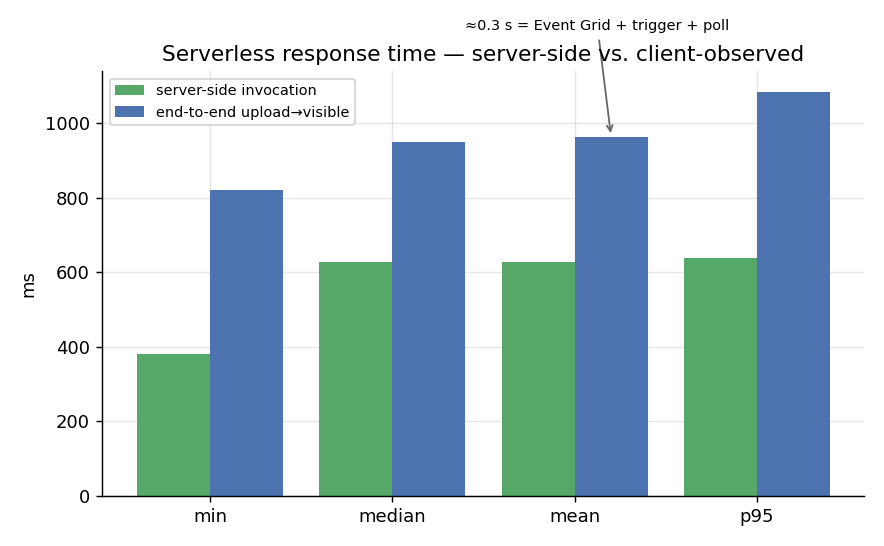
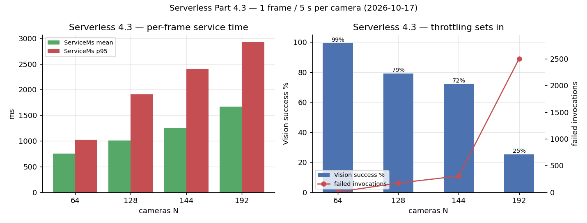

# Serverless remeasurement — Part 3.6 + Part 4.3 (2026-10-17)

Working report for the re-measurement of the **Part 3 serverless pipeline** (response time and
detection efficiency, Task 3.6; multi-camera limit, Task 4.3). Raw captures in `data/sweeps/`
(gitignored); committed per-frame slices in `docs/sweeps/`. Not the graded deliverable.

> **Plots** (this directory): [`sender-capacity.png`](sender-capacity.png),
> [`serverless-latency.png`](serverless-latency.png),
> [`serverless-4.3-n-cameras.png`](serverless-4.3-n-cameras.png). Regenerate with
> `venv/bin/python scripts/plot_measurements.py`.

## Setup

- **Pipeline** — Function App `<function-app>` (Flex Consumption), AI Vision `<vision-account>` (S1),
  storage `<storage-account>` (`raw` → Event Grid `raw-blob-created` → Function → `$web`). Confidence
  threshold 0.30 (default, verified: a clip frame counts 7 people, not ~100).
- **Sender / source** — `src/local_stream.py` driving the **local clip** `data/people_walking.mp4`
  (1920×1080, ≈365–500 KiB JPEG). No live webcam.
- **Sender is not the bottleneck** — proven with the local-sink capacity test in
  [`vm-remeasure-2026-10-17.md`](vm-remeasure-2026-10-17.md): the sender's ceiling is **≈2400 fps**,
  ~80× the highest rate used here, and it delivered **100 %** of the offered frames at every `N`
  below (`sent == offered`).

## T3 — end-to-end (upload → visible) response time

`src/measure_serverless.py --frames 10 --interval 0.5 --image <real frame>` uploads one frame at a
time to `raw` and waits for `$web/database.csv`'s ETag to change (client-observed, covering Event Grid
delivery, the trigger, the `$web` write and the poll):

| Stat | upload→visible | raw blob cleared |
| --- | --- | --- |
| min | 820 ms | 30 ms |
| **median** | **951 ms** | 31 ms |
| mean | 964 ms | 58 ms |
| p95 / max | 1085 / 1085 ms | 294 ms |

`csv rows added: 10 (expected 10)` — no losses; detected people mean 6.0.

> **Probe fix.** `measure_serverless._counts()` assumed the legacy `Timestamp,Person_Count` schema and
> read column 1 (the *camera* in the multi-camera `Timestamp,Camera,Person_Count` schema), so the
> duplicate/loss check always read `0`. It is now header-driven; a test covers the 3-column schema.

## Task 3.6 — server-side (healthy run)

One frame every 0.5 s for 180 s, then `deploy/measure_part3.sh --minutes 5` (read-only `az`):

| Metric | Value |
| --- | --- |
| invocation duration (`process_frame`) | avg **628 ms**, p95 638 ms, max **36.2 s** (cold start), min 381 ms |
| invocations | 355 calls, **0 failed**, 0 exceptions |
| AI Vision | 362 calls, **all successful**, ≈314 ms each |
| Event Grid | 362 published / 362 matched / 362 delivered / 0 failed |
| compute | 246 executions, 289.6 M MB·ms |
| storage | ingress 245 MB, egress 126 MB (page polling dominates) |

Frames processed = Event Grid matched = Vision calls = **362**; every upload produced exactly one
result. Consistent with the 2026-10-11 run (avg 0.65 s, 0 failures).

**E2E vs server-side.** Upload→visible (≈0.95 s) is ≈0.3 s above the server-side invocation duration
(≈0.63 s) — that gap is Event Grid delivery + trigger + the client's own poll, which the invocation
timing cannot see. This is the number a viewer waits for (T3).

## Task 4.3 — multi-camera

`deploy/sweep_serverless.sh --cameras "64 128 144 192" --seconds 60` (1 frame / 5 s per camera, 60 s
window, `$web`/`raw` reset per N, `$web/processing.csv` downloaded per N). "offered" = `N × 12`.

| `N` | offered | frames sent | rows processed | `ServiceMs` mean / p95 | Vision success | failed invocations | server-side avg | verdict |
| --- | --- | --- | --- | --- | --- | --- | --- | --- |
| 64 | 768 | **769 (100 %)** | 769 | 757 / 1027 ms | 99 % (781/787) | 5 | 873 ms | healthy |
| 128 | 1536 | **1537 (100 %)** | 1537 | 1008 / 1912 ms | 79 % (1036/1309) | 172 | 1379 ms | keeps up, throttling |
| 144 | 1728 | **1729 (100 %)** | 1729 | 1251 / 2400 ms | 72 % (2000/2772) | 303 | 1869 ms | keeps up, throttling |
| **192** | 2304 | **2304 (100 %)** | 2167 (94 %) | 1669 / 2926 ms | **25 % (1210/4801)** | **2502** | 2493 ms | **overflow** |

Per-frame evidence (committed): `docs/sweeps/serverless-4.3-processing-N{64,128,144,192}.txt`.

- **N ≤ 144 kept up; N=192 overflows.** Up to 144 the sender delivered 100 % of frames and the function
  processed them all within the window (the `processing.csv` span ≈ the 60 s stream), so the `raw`
  backlog drained. At **192** the sender still delivered 100 %, but the `raw` backlog **built to ~350
  during the stream, then stalled at 138** and never drained — ~137 frames (2304 − 2167) were never
  processed. `QueueMs = 0` throughout (the serverless path has no lock queue; `ServiceMs` is the whole
  invocation).
- **The failure mode is a 429 retry storm, exactly as in 2026-10-11.** At 192 the AI Vision success
  rate collapses to **25 %** (1210/4801 calls), **2502** invocations fail, and per-frame latency rises
  to 1.7 s mean / 2.9 s p95 — Vision throttles, the bounded retry + Event Grid redelivery re-calls it,
  and the backlog freezes in Event Grid's backoff instead of draining.
- **The efficiency knee is ~64–128.** Even while it keeps up, throttling rises steadily (success
  99 % → 79 % → 72 %) and invocation failures climb (5 → 172 → 303) — well before any frame is lost.
- **Ceiling: between 144 and 192.** The 2026-10-11 pass put it at ~128 (144 overflowed); this run shows
  **144 drains and 192 overflows**, so the ceiling is **144–192** (up from the historical ~128).

## Cost (Task 3.6 + 4.3)

Read with `deploy/cost.sh`. Scope RG **`<serverless-resource-group>`**:

| Window | Spend | Notes |
| --- | --- | --- |
| Oct 17 (measurement day) | **€0.0072** | Storage only — the **AI Vision line is pending** (meter lags) |
| Month to date | **€30.26** | Foundry Tools (AI Vision) €29.01, Storage €1.20, Event Grid €0.05 |

**AI Vision dominates** (≈96 % of the month) and it all posted on **Oct 11** (the N=256 sweep day).
The Vision meter **lags several days**, so the Oct 17 figure is a **lower bound** — re-run
`bash deploy/cost.sh --rg <serverless-resource-group>` in a couple of days to capture it. Functions and App
Service bill €0.00.

## Caveats

- Azure Monitor windows lag (~1–5 min) and overlap between `N`, so the per-`N` metric counts above are
  **approximate**; the per-frame `processing.csv` slices are the reliable evidence. Event Grid matched
  = frames processed is the trustworthy count.
- The Vision **retry storm is partly self-inflicted** (our bounded 429-retry plus Event Grid
  redelivery); a production pipeline would dead-letter poison events. `raw`/`$web` were reset after the
  sweep to clear any backlog.
- **Cost is not measured here** — Portal Cost Management (see the cost instructions).

## Raw captures

- `data/sweeps/serverless-64.txt`, `-128.txt`, `-144.txt` — sender log + `measure_part3` report per `N`.
- `data/sweeps/serverless-{64,128,144}-processing.csv` — per-frame `ProcessingMs,QueueMs,ServiceMs`.
