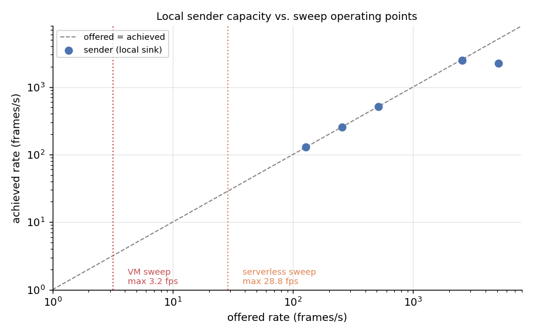
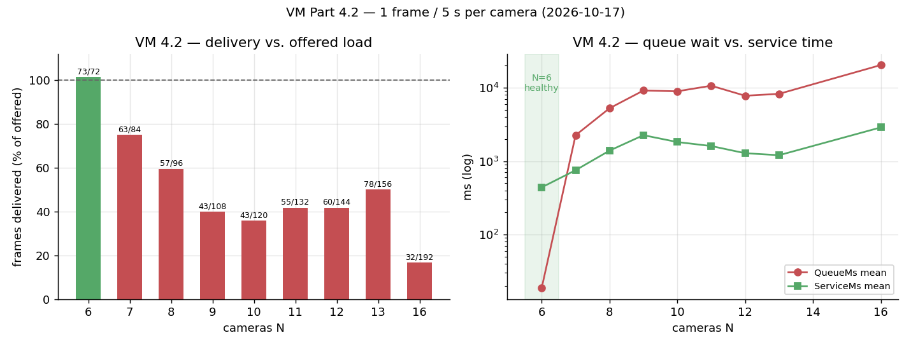
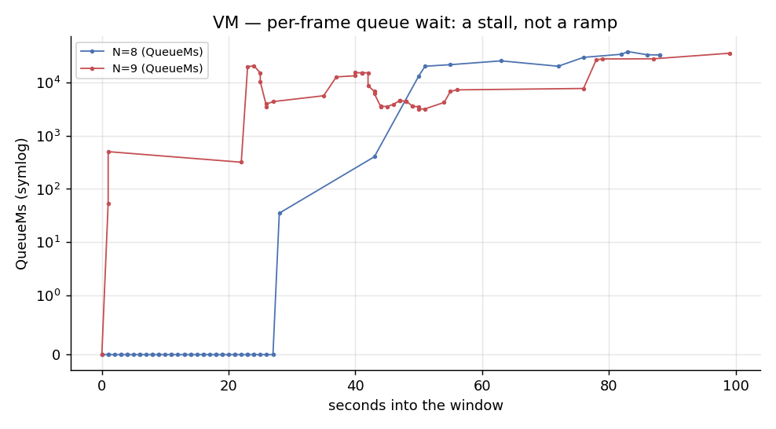

# VM remeasurement — Part 2.5 + Part 4.2 (2026-10-17)

Working report for the re-measurement of the **Part 2 VM** (single-stream performance, Task 2.5;
multi-camera limit, Task 4.2). Raw tool captures live in `data/sweeps/` (gitignored) and the committed
slices in `docs/sweeps/`. Not the graded deliverable — see `docs/AGENTS.md`.

> **Plots** (this directory): [`sender-capacity.png`](sender-capacity.png),
> [`vm-4.2-n-cameras.png`](vm-4.2-n-cameras.png),
> [`vm-4.2-queue-timeline.png`](vm-4.2-queue-timeline.png). Regenerate with
> `venv/bin/python scripts/plot_measurements.py`.

## Setup

- **Target** `<vm-host>` — RG `<vm-resource-group>`, `<vm-public-ip>`, `Standard_B2ats_v2` (2 vCPU, 887 MiB RAM,
  2 GiB swap). Receiver `sls-receiver` (`src/cloud_receiver.py`, YOLOv8n, `imgsz=1280`).
- **Upload path** — the NSG exposes only 80/22, so frames go through an SSH local-forward
  (`localhost:8000 → VM 127.0.0.1:8000`), exactly as the deployed system uses.
- **Sender / source** — `src/local_stream.py` driving the **local clip** `data/people_walking.mp4`
  (1920×1080, JPEG q90 ≈ **365 KB**) at the Part 4 cadence of **1 frame / 5 s per camera**. No live
  webcam, so the measurement is not bound by the live stream.
- **Window** — 60 s per camera count `N`; receiver restarted before each `N` (clean swap) then primed
  (see Method change).

## Method change: prime the detector after each restart

The receiver's startup `warm_up()` runs on a **synthetic 480×640** frame, but real frames are
1920×1080, so the first real frames cost seconds each and build a cold-start queue that swamps the
window. Without priming, a healthy `N=8` looked like a collapse:

| `N=8`, first sweep | rows | `QueueMs` mean / max | `ServiceMs` mean |
| --- | --- | --- | --- |
| no prime (cold) | 34 | 5930 / 13 638 ms | 997 ms |
| primed | 97 | **4.3 / 281 ms** | 403 ms |

`deploy/sweep_vm.sh` now primes with 12 real frames after the restart and resets the docroot before the
window. With priming, `N=8` delivers **97/96 frames** and `QueueMs ≈ 0`.

## Sender is not the bottleneck (proof)

Measured against a throwaway **local discard sink** (no Azure), so it isolates the sender's
decode + JPEG-encode + HTTP cost:

| `N` | interval | offered | frames sent | achieved | local CPU |
| --- | --- | --- | --- | --- | --- |
| 64 | 0.5 s | 128 fps | 1923 | 128 fps | — |
| 128 | 0.5 s | 256 fps | 3844 | 256 fps | — |
| 256 | 0.5 s | 512 fps | 7682 | 512 fps | — |
| 256 | 0.1 s | 2560 fps | 24 600 | **2460 fps** | 1123 % (11 of 32 cores) |
| 256 | 0.05 s | 5120 fps | 22 347 | **2235 fps** | 922 % |

The sender's ceiling is **≈ 2400 fps** (one shared decoder + `N` encoders). The sweeps offer at most
`16/5 = 3.2 fps` (VM) and `144/5 = 28.8 fps` (serverless) — **~75–750× below** the sender's capacity.
In the healthy run the sender also delivered **100 %** of the offered frames (`N=8`: 97/96). The sender
is therefore not the limiting factor; the per-run `sent`/offered counts below are the same evidence at
each `N`.

## Part 4.2 — multi-camera results

Every sweep below: local clip, 1 frame / 5 s per camera, 60 s window, receiver restart + prime per `N`.
"offered" = `N × 12` frames. `QueueMs` = wait for the single processing lock; `ServiceMs` = detect +
write.

**Clean run** (fresh reboot, 180 s settle) — the healthy side and the first collapse:

| `N` | offered | frames processed | `QueueMs` mean / max | `ServiceMs` mean | CPU (% 1 core) | cgroup / peak | swap | verdict |
| --- | --- | --- | --- | --- | --- | --- | --- | --- |
| **6** | 72 | **73** | **19 / 581** | 439 ms | 51 % | 538 / 571 MB | 240 MB | **healthy** |
| 8 | 96 | 57 | 5264 / 37 943 | 1392 ms | 34 % | 574 / 585 MB | 351 MB | collapse |

**Broader session** (restart + prime; `N=8` healthy once, everything ≥7 collapsed in the other runs —
the VM is memory-state dependent):

| `N` | offered | frames processed | `QueueMs` mean / max | `ServiceMs` mean | verdict |
| --- | --- | --- | --- | --- | --- |
| 8 (first run) | 96 | **97** | 4 / 281 | 403 ms | healthy |
| 7 | 84 | 63 | 2257 / — | 753 ms | collapse |
| 9 | 108 | 44 | 9190 / 35 268 | 2261 ms | collapse |
| 10 | 120 | 44 | 8972 / — | 1823 ms | collapse |
| 11 | 132 | 55 | 10 685 / 48 107 | 1608 ms | collapse |
| 12 | 144 | 61 | 7803 / 42 042 | 1284 ms | collapse |
| 13 | 156 | 78 | 8279 / — | 1206 ms | collapse |
| 16 | 192 | 33 | 20 444 / 57 021 | 2886 ms | collapse |

### What the timeline shows

The collapse is a **stall**, not a smooth queue ramp:

The receiver processes a few frames at ~0.4 s each (`QueueMs = 0`), then processes **nothing for ~60 s**
(matching the sender's client timeout), then a backlog burst. `ServiceMs` degrades to seconds while
`swap` climbs to 0.5–0.8 GB. The failure mode is the same as 2026-10-11 — **memory-bound swap thrash** —
but it now triggers much earlier.

### Result

- **On the current VM the knee is ≈ 6 cameras**, not the 13 of 2026-10-11. On a freshly-rebooted VM,
  `N=6` is clean (73/72, `QueueMs` 19 ms, 51 % of one core) and `N=8` already collapses (57/96, queue
  5.3 s). Every `N ≥ 7` collapsed in all runs; `N=8` came out healthy once (97/96) but is
  non-deterministic.
- The receiver's cgroup memory is **~0.57–0.64 GB** on the 887 MiB VM, leaving ~250 MB headroom; under
  `N`-camera concurrency the box swaps and the receiver stalls. The per-frame cost is unchanged
  (`ServiceMs ≈ 0.40 s`, same as the historical 0.38 s) — the box just runs out of memory at a lower `N`.
- The VM is **memory-marginal even at rest**: after 5 days of uptime it held **865 MB of swap idle**
  (a receiver stop/start reclaims it, 917 → 95 MB; a reboot clears it to ~60 MB).

## Part 2.5 — single-stream baselines

`deploy/measure.sh` run on the VM (idle / a 12-frame self-load / an egress window).

| Scenario | CPU (process) | cgroup mem | network `eth0` | latency |
| --- | --- | --- | --- | --- |
| Idle (15 s) | 0.00 s (0 %) | 558 MB current / 621 MB peak | ≈ 0 | — |
| Inference, 12 frames | 5.12 s (21 % of one core) | 415 MB current / 621 MB peak | tx 8.37 MB | round-trip median **432 ms** (server median 423 ms, p95 2.2 s, max 2.9 s) |
| Egress, 40 page polls (22 s) | 0.00 s (0 %) | 565 MB current / 619 MB peak | **tx 16.27 MB (5.91 Mbps)** | — |

- **Single-stream detection ≈ 0.42–0.43 s/frame** (server-side), consistent with the historical
  ~0.37 s. The first request after idle is slower (p95 2.2 s) — model warm-up, as before.
- **Egress dwarfs ingress.** The served annotated frame is **0.53 MB**; one open page polling it every
  0.5 s costs **~6 Mbps ≈ 64 GB/day** (~21 MB of egress for 40 polls). The same lever as Part 2:
  downscale the image or poll less.
- The idle `swap` (986 MB) reflects the degraded VM state at that point in the session, not the
  scenario.

## Cost (Part 2.5 + 4.2)

Read with `deploy/cost.sh` (Cost Management REST API — `az consumption` returns `null` on this
subscription). Scope RG **`<vm-resource-group>`**:

| Window | Spend | Notes |
| --- | --- | --- |
| Oct 17 (measurement day) | **€0.0305** | operating-system disk; **Virtual Machines €0.00** |
| Month to date | €1.51 | Storage €1.51; Virtual Machines €0.00 |

The VM compute (`Standard_B2ats_v2`) bills **€0.00** on this student subscription, so the VM's only
cost is the ≈€1.51 OS disk (≈€0.03/day). `bash deploy/cost.sh --rg <vm-resource-group> --from 2026-10-17 --to 2026-10-18`.

## Caveats

- The VM is in a **degraded, memory-marginal state** (5-day uptime, swap accumulating, effective CPU
  lower than the historical run: `N=10` at 25–38 % of one core vs 78 % on 2026-10-11). The exact knee
  is therefore not reproducible run-to-run, and the numbers above are a **lower bound** for the current
  box rather than a stable platform limit. A clean number needs a freshly-rebooted VM measured
  immediately (the historical protocol), which still did not reach `N=13` in this session.
- `N=6`/`7` were only sampled in one late, already-degraded sweep (no `QueueMs` capture); they are
  marked "degraded" from their low `sent` counts.
- Cost is not measured here (Portal, see the cost instructions).

## Raw captures

- `data/sweeps/vm-{6,7,8,9,10,11,12,13,16}.txt` — `measure.sh` reports + sender totals (per run).
- `data/sweeps/vm-{6,7,8,9,10,11,12,13,16}-processing.csv` — per-frame `ProcessingMs,QueueMs,ServiceMs`.
- Committed slices: `docs/sweeps/vm-4.2-processing-N10.txt`, `docs/sweeps/vm-4.2-processing-N14.txt`.
